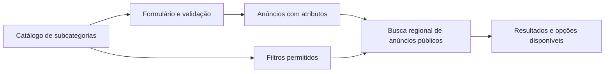

# Categorias, formulário de anúncio e filtros da OLAQUI

O catálogo da subcategoria define quais dados pedir no anúncio e quais podem virar filtros. A busca regional calcula quais opções têm anúncios disponíveis. O objetivo é conseguir publicar um anúncio com os campos do seu tipo, encontrá-lo com esses mesmos dados e trocar de subcategoria sem carregar campos incompatíveis.

O recorte cobre criação, edição, listagem por categoria e `/busca` quando há uma subcategoria selecionada. A home usa `catalogo_anuncios` e segue seu fluxo de vitrine. O Radar mantém o vínculo com as categorias atuais. [Home](<../src/app/(publico)/page.tsx#L45>) · [Catálogo regional](../supabase/migrations/20261110150000_catalogo_regional.sql#L108) · [Vínculo com o Radar](../supabase/migrations/20261107020000_categorias_e_anuncios.sql#L78)

## Referência da OLX Brasil

| Evidência pública | Aplicação proposta na OLAQUI |
| --- | --- |
| A Central de Ajuda orienta escolher categoria e subcategoria, preencher informações adicionais e retomar um anúncio incompleto como rascunho. A documentação de importação distingue campos gerais dos específicos da subcategoria. [Publicação](https://ajuda.olx.com.br/s/article/como-publicar-anuncio) · [Imóveis](https://developers.olx.com.br/anuncio/json/real_estate/home.html#parametros-especificos-por-subcategoria) | Reutilizar as etapas atuais e carregar os detalhes após a escolha da subcategoria. |
| Carros oferece faixas de ano e quilometragem, câmbio e combustível. A página de Honda passa a listar modelos da marca, como Civic e Fit. A documentação de importação de carros declara ano, quilometragem, marca e modelo como campos do veículo. [Carros](https://www.olx.com.br/autos-e-pecas/carros-vans-e-utilitarios) · [Honda](https://www.olx.com.br/autos-e-pecas/carros-vans-e-utilitarios/honda) · [Campos de carros](https://developers.olx.com.br/anuncio/api/autos/sub_auto.html) | Usar faixas para números, seleções para valores padronizados e dependência Marca → Modelo quando houver um catálogo próprio confiável. |
| Apartamentos exibe quartos, vagas e área. Celulares exibe marca, condição e memória. [Apartamentos](https://www.olx.com.br/imoveis/venda/apartamentos) · [Celulares](https://www.olx.com.br/celulares) | Cada subcategoria expõe apenas os filtros úteis para comparar seus anúncios. |

O REA capturou a Central de Ajuda (`ev_09572feb5b8e1139837deef17089b61c7d392aab05c5545ae72bfd4e960e2491`) e o portal de integração (`ev_513d23d1dbc8f3a43cf1864035b760e6373d64b3f6edb12fd69825248d63ba92`). Nas listagens de carros e apartamentos, a sessão automatizada recebeu uma tela de bloqueio (`ev_801df3c253b78a7381c2b9fec860afcac9e27d19508b4e5c87188804fb75540a`). A comparação dos filtros usa as páginas públicas indexadas. O formulário autenticado ficou fora da observação direta. A forma como a OLX calcula a disponibilidade dos filtros ficou indeterminada.

## O que o código da OLAQUI já oferece

| Parte | Comportamento no repositório |
| --- | --- |
| Catálogo | `categorias` tem dois níveis. A subcategoria define `campos` em JSONB, com chave, rótulo, tipo, obrigatoriedade, unidade, opções e indicação de filtro. `anuncios` guarda `categoria_id` e `atributos`. O painel `/admin/categorias` já permite editar os campos. [Tipos](../src/lib/tipos.ts#L6) · [Schema](../supabase/migrations/20261107020000_categorias_e_anuncios.sql#L65) · [Editor](../src/app/admin/categorias/editor-campos.tsx#L57) |
| Cadastro e edição | `/anunciar/detalhes` exibe campos de texto, número, lista e sim/não conforme a categoria escolhida. O fluxo salva rascunhos e valida os valores na ação do servidor e no banco. [Detalhes](<../src/app/(conta)/anunciar/detalhes/page.tsx#L14>) · [Ação de salvar](<../src/app/(conta)/anunciar/actions.ts#L210>) · [Validação](../supabase/migrations/20261107020000_categorias_e_anuncios.sql#L351) |
| Busca | `/busca` e `/c/...` usam `Listagem`. A categoria principal agrega as subcategorias, e a subcategoria selecionada expõe os campos marcados como filtro. A URL já suporta `c_<chave>` e faixas. `buscar_anuncios` filtra antes de paginar e considera a região, o estado do anúncio e o da vitrine. As listas ainda exibem as opções configuradas no catálogo, mesmo quando a busca regional tem zero anúncios para uma opção. [Listagem](../src/components/busca/listagem.tsx#L33) · [Parâmetros](../src/components/busca/parametros.ts#L71) · [Consulta](../supabase/migrations/20261107030500_destaques.sql#L1020) |

## Catálogo e formulário

Manter a estrutura de dois níveis e as URLs atuais. Categorias principais organizam a navegação. O anúncio é associado a uma subcategoria, que define seus detalhes. Usar `categorias.campos` como fonte única para publicar, editar, validar e definir quais filtros podem aparecer. `obrigatorio` controla a publicação. `filtro` controla a busca.



1. Manter as etapas Fotos, Categoria, Detalhes, Preço, Local e Revisar. Depois de escolher a subcategoria, mostrar título e descrição com os detalhes correspondentes. Exibir unidade no campo e mensagem junto ao valor inválido. Usar a mesma regra para criar e editar. Permitir salvar e retomar o rascunho incompleto e exigir os campos obrigatórios ao publicar. [Etapas atuais](../src/components/anunciar/passos.ts#L3)
2. Ao trocar a subcategoria de um rascunho, avisar quais valores sairão e preservar os campos comuns e os atributos que continuem válidos com o mesmo significado, tipo e unidade. Hoje a seleção dos atributos é feita só pela chave. `area` de Casas é em m² e `area` de Fazendas e sítios é em ha. A troca deve pedir o novo valor. [Troca atual](<../src/app/(conta)/anunciar/actions.ts#L192>) · [Unidades](../supabase/migrations/20261107020000_categorias_e_anuncios.sql#L213)
3. Na edição de um anúncio que já foi publicado, preparar os novos detalhes antes de gravar a troca de categoria. Gravar categoria e atributos na mesma transação, conferindo a revisão do anúncio e os campos vigentes para evitar perda por edição concorrente. Reaplicar as regras de publicação e moderação. Preservar `tipo_legado` e `finalidade`, que já têm consumidores. [Validação do anúncio](../supabase/migrations/20261107020000_categorias_e_anuncios.sql#L430) · [Moderação de aluguel](../supabase/migrations/20261110020853_moderacao_aluguel.sql#L38)

### Subcategorias para validar o modelo

| Subcategoria | Campos específicos para a primeira validação | Filtros do feed |
| --- | --- | --- |
| Veículos → Carros | Marca, modelo, ano, quilometragem, câmbio e combustível. Começar com os campos atuais. | Ano e km por faixa, câmbio e combustível por opções disponíveis. Marca mantém a entrada de texto até ter valores padronizados. |
| Imóveis → Casas | Venda ou aluguel, quartos, banheiros, vagas e área em m². | Finalidade, quartos, banheiros, vagas e área. Combinar finalidade com preço para comparar ofertas do mesmo tipo. |
| Agro → Tratores e máquinas | Marca, modelo, ano, horas de uso, potência e estado. | Horas de uso, potência, ano e estado. Valida uma unidade diferente da usada nos carros. |
| Eletrônicos → Celulares | Marca e estado já existem. Propor armazenamento em lista opcional, com rótulos padronizados como `128 GB`. | Estado e, quando houver dados preenchidos, armazenamento. Marca e modelo estruturados entram com um catálogo próprio validado. |
| Serviços → Fretes | Usar os dados comuns na primeira versão. | Cidade e preço informado. O painel de atributos fica oculto enquanto a subcategoria estiver sem campos filtráveis. |

Carros e Casas são os primeiros casos de teste ponta a ponta. Tratores e Fretes servem para verificar unidades e o caso sem campos extras. A seleção das subcategorias que recebem a primeira liberação comercial depende do estoque real da região. [Catálogo inicial](../supabase/migrations/20261107020000_categorias_e_anuncios.sql#L221) · [Recorte regional do produto](PRODUTO-CONTAS-ANUNCIOS-ROBO.md#L65)

## Filtros que acompanham a oferta

- **Categoria principal ou busca ampla.** Mostrar subcategorias, termo, cidade, preço e ordenação. Ao entrar em uma subcategoria, carregar os controles definidos para ela. Na troca, manter termo, cidade, faixa de preço e ordenação e limpar atributos incompatíveis. Voltar à primeira página. Os filtros aplicados continuam na URL.
- **Opções e faixas.** Após aplicar filtros ou mudar termo, cidade ou subcategoria, calcular a disponibilidade sobre todo o conjunto de anúncios públicos elegíveis, antes de ordenar ou paginar. Usar a mesma microrregião, cidade, categoria, termo e faixa de preço da lista principal. As sugestões de outras regiões ou categorias ficam em seção separada e fora das contagens.
- **Combinação.** Aplicar E entre campos diferentes e OU entre escolhas do mesmo campo. Para uma opção, contar anúncios que combinam com os demais filtros, desconsiderando temporariamente a seleção daquele próprio campo. Cada anúncio conta uma vez por opção. Para números, mostrar a menor e a maior medida válidas sob os demais filtros. Distinguir dado ausente de zero e de `false`.
- **Opções zeradas.** Ocultar opções indisponíveis que a pessoa ainda não selecionou e recolher grupos sem valores disponíveis ou seleção. Manter o filtro aplicado visível e removível mesmo quando voltar com zero resultados. Validar a URL pelo catálogo completo, separado da disponibilidade. Se um filtro antigo deixou de existir, apresentar a opção de removê-lo ou traduzir seu valor quando houver um mapeamento explícito. Mostrar estado vazio com o caminho para limpar os filtros.
- **Texto livre e dependências.** Manter a busca atual para campos de texto, como marca. Para oferecer uma lista com contagens, padronizar o campo antes. No caso Marca → Modelo, o formulário oferece os modelos válidos para a marca, e a busca restringe as opções aos modelos das marcas selecionadas com oferta na consulta. Ao trocar marca, manter apenas modelos compatíveis.

### Exemplo de aceite com dados fictícios

Em Carros, a busca em Corrente tem três anúncios públicos com quilometragem preenchida. Há um automático com 62 mil km, um manual com 70 mil km e outro automático com 96 mil km. Com **Automático** e **até 80 mil km**, o feed traz só o primeiro. As opções de câmbio mostram **Automático (1)** e **Manual (1)** para essa faixa. Se o usuário selecionar os dois câmbios, aparecem os dois carros dentro da faixa. Um carro vendido, um carro sem quilometragem e um carro de outra região ficam fora desse resultado. O link reproduz a busca ao ser aberto na mesma região. [Convenção da URL](../src/components/busca/parametros.ts#L20)

```text
/c/veiculos/carros?cidade=Corrente&c_cambio=Autom%C3%A1tico&c_km_max=80000
```

## Implementação em ordem

| Etapa | Entrega e condição para avançar |
| --- | --- |
| 1. Conferir o catálogo | Inventariar por subcategoria e região anúncios ativos, preenchimento e valores divergentes. Rever a lista com a equipe do piloto. Registrar para cada campo a chave, o tipo, a unidade, a obrigatoriedade, os valores válidos e se deve aparecer no feed. Aprovar exemplos reais de cada subcategoria escolhida. |
| 2. Proteger cadastro e edição | Evoluir o editor atual e o fluxo `/anunciar`. Manter chaves estáveis e adicionar campos novos como opcionais primeiro. Hoje o texto de cada opção também é seu valor gravado. Para renomear opções em uso ou mudar tipo/unidade, preparar mapeamento explícito e migração testada. Preservar valores legados durante a edição e retirar campos descontinuados dos filtros. Usar a ocultação existente para tirar subcategorias da escolha sem remover seus anúncios. [Valores de lista](../supabase/migrations/20261107020000_categorias_e_anuncios.sql#L404) · [Proteção de categorias em uso](../supabase/migrations/20261108040000_regioes_categorias.sql#L428) |
| 3. Entregar resultados e disponibilidade juntos | Criar uma consulta regional de busca com facetas, nome proposto `buscar_anuncios_com_facetas`, retornando `anuncios`, `total` e `facetas` no mesmo retrato do banco. Compartilhar os critérios de elegibilidade e de correspondência com `buscar_anuncios`, preservando o contrato antigo para os outros chamadores. Aceitar apenas chaves e operações permitidas pela subcategoria e usar a mesma interpretação de números, listas e booleanos da busca. Restringir as agregações aos anúncios elegíveis para a lista pública. Calcular contagens para listas e sim/não e faixas para números. |
| 4. Ligar aos filtros atuais | Integrar `Listagem`, `ResultadosBusca` e `FolhaFiltros`. Ao mudar de subcategoria no painel, trocar os controles na hora e carregar as novas contagens ao aplicar. Exibir contagens apenas para a consulta a que pertencem. Manter a ordenação, os destaques elegíveis, os chips removíveis e a navegação pelo histórico. Mostrar erro recuperável se a busca falhar, distinto de uma busca válida vazia. |
| 5. Liberar na região-piloto | Comparar resultados e latência com a busca atual usando dados representativos, incluindo filtro combinado e opções fora da primeira página. Medir p95 e examinar as consultas antes de decidir índices adicionais. Ativar a consulta nova por configuração do piloto. Se houver divergência de resultados ou regressão de latência, voltar à consulta atual pela configuração. |
| 6. Ampliar o catálogo | Adicionar novos campos e subcategorias pelo painel e repetir a verificação. Estruturar Marca → Modelo primeiro na categoria que tiver oferta e um conjunto de opções verificável. Manter os valores antigos legíveis e compatibilizar links antigos quando a equivalência for conhecida. |

## Aceite antes da liberação

| Cenário | Resultado esperado |
| --- | --- |
| Criar e retomar rascunho de Carros e Casas | Cada categoria mostra só seus detalhes. Valores comuns, fotos e campos já preenchidos voltam ao retomar. O servidor e o banco recusam valores inválidos e impedem publicar com campos obrigatórios vazios. |
| Trocar Casas por Fazendas e sítios | A interface informa a mudança, pede área em hectares e mantém os campos comuns. Se a gravação da troca falhar, categoria e atributos anteriores continuam íntegros. |
| Editar anúncio anterior à atualização | Campos novos opcionais ficam vazios até preenchimento. Edição preserva os dados existentes, inclusive em categoria ocultada. Conferir a transição de moderação quando a finalidade muda para aluguel. |
| Combinar filtros, trocar categoria e voltar pelo navegador | E/OU, faixas, valores zero e `false`, cidade e ordenação são reproduzíveis pela URL. Os filtros específicos incompatíveis saem na troca. A contagem usa todos os resultados elegíveis, inclusive os de páginas posteriores. |
| Testar oferta pequena e nenhum resultado | Uma opção selecionada com zero continua removível. Uma subcategoria sem atributos filtráveis mantém os controles gerais. Rascunhos, anúncios em análise, vendidos, anúncios de vitrine inativa e sugestões de outra região ficam fora das contagens. |
| Conferir o painel administrativo | Um campo novo configurado na subcategoria aparece no cadastro e pode virar filtro quando houver valores válidos. Só a equipe autorizada altera o catálogo. Mudanças que afetam dados existentes passam pela revisão de impacto. |

Partir dos testes de busca e publicação existentes e acrescentar os casos específicos de contagem, isolamento regional e troca de unidade. Validar em banco descartável e percorrer o fluxo no navegador em largura de celular. [Testes de busca](../tests/busca.test.cjs) · [Busca no banco](../supabase/testes/160_busca_filtros.sql) · [Publicação no banco](../supabase/testes/180_criar_publicar_anuncio.sql)
